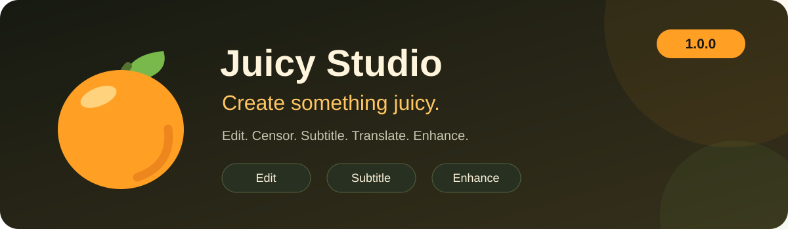
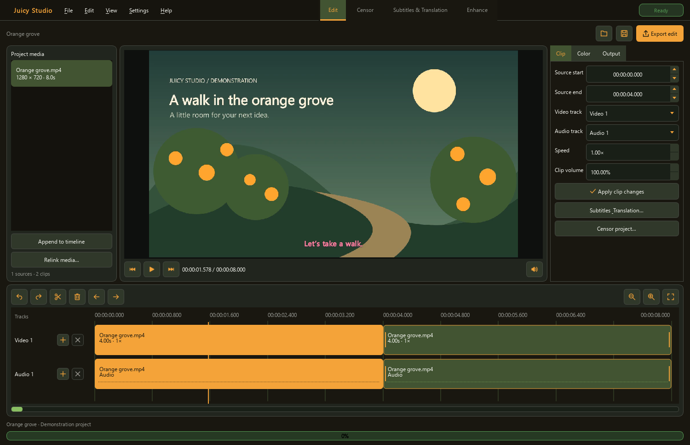
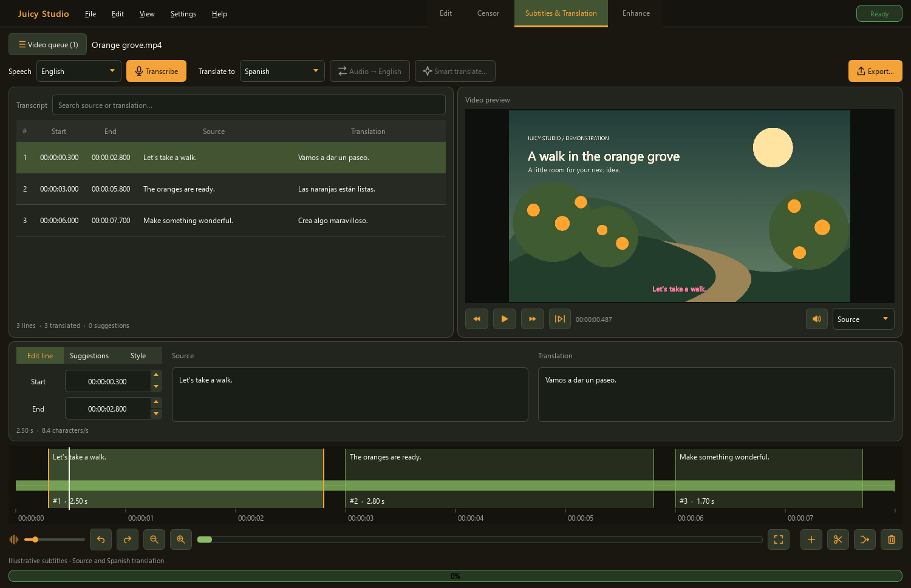

**Edit video. Filter dialogue. Create subtitles. Enhance the picture.**

Juicy Studio brings these tools into one orange-themed Windows workspace.
Start with a project, move between tools, and export without changing your original media.
Formerly JuicyCensor; earlier releases remain available.

**[Download Windows installer](https://github.com/seagullslayer7/JuicyCensor/releases/download/studio-v1.0.0/JuicyStudio-1.0.0-Windows-x64-Setup.exe)** · [Portable ZIP](https://github.com/seagullslayer7/JuicyCensor/releases/download/studio-v1.0.0/JuicyStudio-1.0.0-Windows-x64-Portable.zip) · [Release notes](https://github.com/seagullslayer7/JuicyCensor/releases/tag/studio-v1.0.0)

*Separate video/audio lanes, a shared project, and compact controls. Demonstration media and subtitles shown.*

## One project, four workspaces

- **Edit** — Import media, trim, split and reorder clips. Adjust speed, clip volume and color; choose your canvas and export settings. Save `.juicy` projects with Undo/Redo and recovery copies.
- **Censor** — Detect words and phrases, refine regions, and listen to censored playback before exporting. Choose silence, continuous/pulsed tones or a custom sound.
- **Subtitles & Translation** — Transcribe multiple languages, search dialogue, edit timing on the waveform, and style captions. Translate audio to English or review context-aware text-model suggestions.
- **Enhance** — Upscale animation or live action, compare a short preview, and choose output resolution, codec and audio settings. Optional restoration controls help balance detail against fidelity.

**Changes travel with the project.** Subtitle and censor edits follow timeline cuts, speed changes and reordering. A completed enhancement can become project media while preserving those annotations; Undo restores the previous timeline.

## Get started

1. Run the installer, or extract the **entire** portable ZIP to a writable folder.
2. Launch **Juicy Studio**. First-run setup installs a private processing environment, FFmpeg and GPU tools. Choose NVIDIA CUDA or the smaller AMD/Intel/CPU setup; starter speech models are optional.
3. In **Edit**, import a video and double-click it to append it. Save with **Ctrl+S**, or manage saved/recent projects through **File → Projects…**.
4. Switch workspaces to censor, subtitle or enhance. Hover over icons for explanations; **Help → User guide…** or **F1** opens the searchable in-app guides.

**Windows 10 (1809+) / Windows 11, 64-bit.** NVIDIA speech processing uses CUDA; AMD/Intel use Vulkan; CPU speech processing is available. Keep your GPU driver current. System Python, Visual Studio and a separate CUDA Toolkit are not required. Allow several GB for runtime and model downloads. The app is unsigned, so Windows may show a publisher warning.

## Subtitles that stay with your video

Transcribe a video or import SRT, VTT, ASS/SSA files. Edit source and translation side by side; choose font, size and color in **Style**. The waveform loads automatically, and its timing blocks can be dragged or resized.

- **SRT / VTT:** plain subtitle files.
- **ASS:** styled subtitles.
- **MP4:** permanent captions burned into the picture; video is re-encoded.
- **MKV:** a subtitle track that compatible players can switch on or off.

Standalone MKV subtitle export can copy the original video/audio. A changed editing timeline must be rendered first. MP4 subtitle exports expose codec, encoder, quality/bitrate and audio controls; existing subtitle files can be used directly without transcription. External ASS/SSA styling is retained, provided its fonts are installed.

## Make it yours

**View → Appearance** offers Orange grove, Midnight, Berry and Graphite, plus color, saturation, brightness, highlight, spacing and corner controls. Save your own presets. Speaker buttons open compact vertical volume controls; preview volume does not change exported audio.

**File → Storage & uninstall…** previews cache/alignment cleanup. Ordinary cleanup preserves projects, subtitle edits, models and exports. Installed builds also offer uninstall with data preserved, or removal of the app and its installation-local data. Full removal deletes projects and exports inside that folder; keep a separate copy of anything you want to retain.

## Models and translation

The optional starter model is multilingual **base**. Larger models such as **small**, **medium** and **large-v3** may recognize speech more accurately, at higher memory/storage cost. Missing models can download later; compatible cached downloads are reused. NVIDIA/CPU and Vulkan use different model formats. English-only `.en` models are unsuitable for other languages.

**Quiet speech / whispers** bypasses voice-activity filtering on NVIDIA/CPU; Vulkan already runs without it. Always review the result for missed or invented dialogue. Automatic censorship may also need a downloadable word-alignment model. Default word lists contain ordinary English profanity, without identity-based slurs; customize them in Settings.

**Local by default:** audio-to-English translation uses Whisper. Smart Translate needs a separately installed local text-model server, or an optional compatible online provider with your API key. Online translation sends selected subtitle text and context, not video/audio. Keys remain in memory for the app session. Suggestions stay separate until accepted; provider charges may apply.

## Current limits

Juicy Studio 1.0 is an editing foundation. Video/audio lanes organize a linked sequence: overlapping layers, independent audio mixing, transitions and keyframes are not implemented yet. Clip color adjustments apply during rendering; the source preview shows original color. HDR timeline export is not supported.

AI enhancement cannot guarantee new detail or correct anatomy and may introduce artifacts. Review a moving preview before a full export. Available restoration options differ by GPU/backend. See the [editing guide](docs/EDITOR-DEVELOPMENT.md) and [enhancement guide](docs/ENHANCE-DEVELOPMENT.md) for details.

## Updating and support

The Studio installer updates earlier **Juicy Studio previews** while retaining local data. JuicyCensor uses a separate installation: back up its settings, lists, projects and media before moving them. The old releases remain in [release history](https://github.com/seagullslayer7/JuicyCensor/releases).

For portable updates, close the app, back up its folder, then replace application files while preserving settings, projects and runtime/model folders. Downloading a ZIP alone does not update an installation.

[Report an issue](https://github.com/seagullslayer7/JuicyCensor/issues) · [Build from source](docs/BUILDING.md) · [Validation](docs/VALIDATION.md) · [Licenses](THIRD-PARTY.md) · [Editor roadmap](docs/EDITOR-ROADMAP.md)
